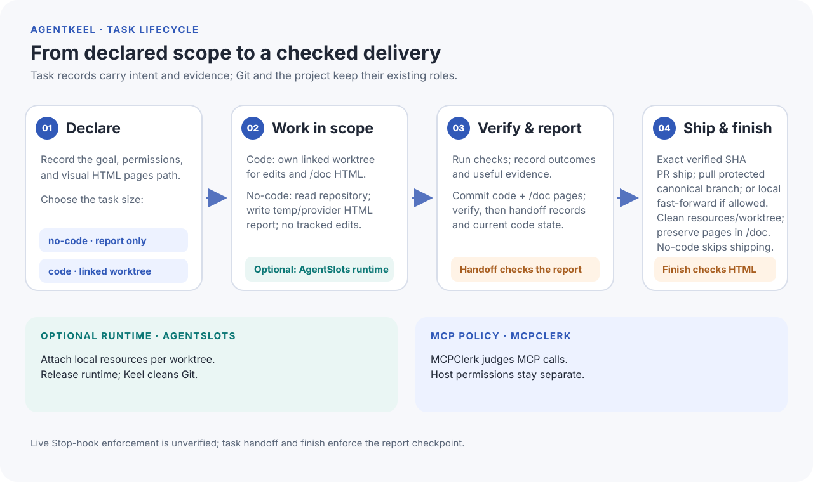

<p align="center">
  <picture>
    <source media="(prefers-color-scheme: dark)" srcset="docs/261005-brand-banner-dark-asset.svg">
    
  </picture>
</p>

<p align="center">
  <a href="https://github.com/hishamalward/agentkeel/actions/workflows/validate.yml"></a>
  <a href="LICENSE"></a>
  <a href="#install-and-opt-in"></a>
</p>

AgentKeel manages task scope from declaration through delivery for Claude Code and Codex. Each task records its permissions and visual HTML pages. Coding tasks keep pages in their linked worktree’s `/doc` folder; no-code tasks use temporary or provider-managed HTML without creating a worktree or editing tracked files. Hooks check supported edits, commands and intercepted MCP calls against that scope. The core uses Python's standard library.



## What it does

- Each session owns one task record outside the repository. `no-code`, `small` and `large` describe task process; permissions independently authorize actions.
- Coding tasks get a linked worktree created by AgentKeel. The session-start message prints its path; the agent must change into it before editing. A `no-code` task has no worktree.
- Returning to an existing linked worktree uses `resume`, with fresh scope and permissions. It preserves the branch, files and index, supports explicit handoff from prior sessions (including legacy claims), and retains the worktree at finish. See [resume](docs/task-record.md#resume-existing-work).
- Present self-contained, visually designed HTML with concrete mockups and visual explanations. Prefer two pages: the specification/full plan (`--spec`) and current progress (`--deliverable`), overwritten in place. No template, fixed sections or content schema. Coding pages belong in the worktree’s root-level `/doc`; no-code pages live in temporary or provider storage. Handoff and finish check declared pages and current code. Stop uses the same checks when invoked, but live host enforcement remains unverified and internal errors fail open.
- `fix` tasks require a recorded failed check and cause before code edits. The guard limits repeated edit/fail cycles; see [Debugging](skills/debugging/SKILL.md).
- Task, secret and fix guards can be set to `block`, `warn` or `off` in the repository's private local policy. MCPClerk policy is separate and fail-closed.
- Shipping is permissioned. `pr` creates a pull request, `ship --pr NUMBER` verifies the exact candidate and merges its PR through GitHub after review/checks, and `ship --local` fast-forwards the exact verified candidate into the clean canonical checkout without a remote. Both use its current configured protected branch; local shipping requires `merge` and no configured `require_check_before_push`; repositories with that policy use PR shipping, which also requires `push`. `finish` releases owned worktree resources after synchronization. Before removing a new coding worktree, finish confirms its declared pages are committed and preserved unchanged in the canonical checkout’s `/doc`. Task status records shipping and cleanup outcomes.
- Intercepted MCP calls are checked by the MCPClerk bridge. Missing or refusing MCPClerk blocks that MCP call; it does not block ordinary coding, and AgentKeel task guard settings cannot soften a Clerk refusal. Host-native permissions and trust remain separate. Calls made through shell, scripts or browsers are outside this check; see [guardrails](docs/guardrails.md).
- `review-page` helps write a useful human review report. Ponytail provides coding preferences; the debugging skill remains the workflow for fixes.

## Install and opt in

Install AgentKeel through the host's plugin marketplace, then opt each repository in. Python 3.10+, git, and bash 3.2+ are required. MCP tool policy is handled by MCPClerk; see [guardrails](docs/guardrails.md#mcpclerk-bridge) for setup and migration instructions.

Claude Code:

```bash
claude plugin marketplace add hishamalward/agentkeel
claude plugin install agentkeel@agentkeel
```

Codex:

```bash
codex plugin marketplace add hishamalward/agentkeel
codex plugin add agentkeel@agentkeel
```

In Codex, open `/hooks` in the repository and trust AgentKeel's hooks. In the repository, run the installed `task.py init` path printed by the host/plugin instructions. Plugin files are cached under a versioned path such as `~/.claude/plugins/cache/agentkeel/agentkeel/0.12.0/hooks/task.py`; session start prints the actual path. `init` registers the repository and stores its policy in private Git metadata shared by its linked worktrees. It does not create or edit repository files. Run `task.py deactivate` to remove both local records.

The default `{}` policy protects `main` and `master`. Every write needs a declared task. To configure optional protected branches, command rules or `require_check_before_push`, pass a JSON object with `task.py init --policy FILE`; see [the policy guide](docs/task-record.md#repository-policy). MCPClerk owns MCP catalog and tool policy.

### MCPClerk bridge

Install MCPClerk separately. Its decisions are independent of native host permissions and task guard modes. The [MCPClerk setup guide](docs/guardrails.md#mcpclerk-bridge) describes configuration and migration from older AgentKeel MCP policy.

## A task from start to finish

The plugin session-start message prints the correct `task.py` path. Start from the shared checkout; AgentKeel creates and records the coding worktree and prints its location. Coding paths resolve relative to that worktree. Progress defaults to `doc/<task>-progress.html`; use `--spec` for a separate specification/full plan. Create and update the pages yourself; Keel does not generate a template.

```bash
python3 "$TASK" start add-json --size small --allow implement,review,merge,push --spec doc/add-json-spec.html
cd /path/printed/by/task.py
# write the spec and progress pages in doc/; edit, check, and commit with explicit paths
# include the pages in the commit, then verify that exact candidate
python3 "$TASK" verify -- python3 -m unittest discover -s tests -q
python3 "$TASK" handoff
python3 "$TASK" pr --title "Add JSON output" --body-file doc/pr-body.txt
python3 "$TASK" ship --pr 123
# For an explicitly authorized administrator exception, add --admin.
# Or, when no require_check_before_push is configured, deliver locally:
python3 "$TASK" ship --local
# Finish preserves committed pages in the canonical checkout’s /doc:
python3 "$TASK" finish
```

Use `--size no-code` for tasks without code changes. `--kind fix` enables the debugging guards; `--kind` may also be `feature`, `review`, `docs` or `chore`. No-code HTML defaults to a session-specific temporary folder; `--deliverable` and optional `--spec` can instead name local files in provider-managed storage outside a repository. `verify` records a foreground check against the current code. `cancel` retains incomplete work and archives its ownership when the session starts another task. Human-only `discard TASK --worktree PATH` releases a cancelled task and explicitly discards its unmerged changes after ownership, runtime and process checks. Normal finish accepts ignored generated caches (`__pycache__`, `.pytest_cache`, `node_modules`, `.DS_Store`); projects can add exact disposable paths through `disposable_ignored` in the private policy. Other ignored local files are preserved unless `finish --discard-ignored` is explicitly chosen; that flag discards all ignored files, including `.env` and local data. `status --json` prints derived state; `status --html` writes a temporary status view.

The legacy human-operated `open`, `import` and `release` commands still provide an isolated clone/session path on supported macOS setups. Their OS sandbox behavior is separate from the normal linked-worktree task flow and is not proven on every host/platform; see [enforcement design](docs/enforcement-design.md).

## Limits

Hooks inspect supported host tool events and parsed shell operations. They cannot contain arbitrary shell scripts, unparsed side effects, browser writes or credentials used outside an intercepted MCP call. Linked worktrees share Git internals with the primary checkout. The optional isolated-clone mode uses host OS sandboxing for a stronger shell boundary, with platform-specific limits. Hooks do not replace host permission prompts or CI checks.

## Documentation

- [Task record, CLI and policy](docs/task-record.md)
- [Free-form HTML delivery](docs/delivery.md)
- [Guardrails and limits](docs/guardrails.md)
- [Host behavior](docs/hosts.md)
- [Captured hook payloads](docs/hook-payloads.md)
- [Enforcement design](docs/enforcement-design.md)
- [Review-page skill](skills/review-page/SKILL.md)
- [Debugging skill](skills/debugging/SKILL.md)

AgentKeel works alongside [AgentSlots](https://github.com/hishamalward/agentslots), which manages local runtime resources such as databases and ports.

## Test

```bash
python3 -m unittest discover -s tests -q
```
