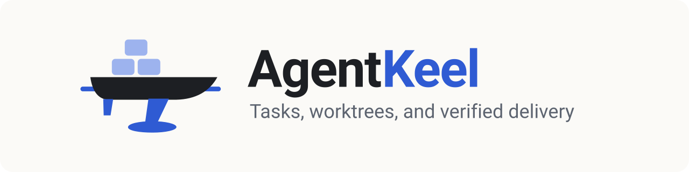

<p align="center">
  <picture>
    <source media="(prefers-color-scheme: dark)" srcset="docs/261005-brand-banner-dark-asset.svg">
    
  </picture>
</p>

<p align="center">
  <a href="https://github.com/hishamalward/agentkeel/actions/workflows/validate.yml"></a>
  <a href="LICENSE"></a>
  <a href="#install-and-opt-in"></a>
</p>

AgentKeel is a guardrail plugin for Claude Code and Codex. Before writing, an agent declares a task, its permissions, a persistent HTML report, and (for code work) gets a linked worktree. Hooks check supported edits, commands and intercepted MCP calls against that scope. The core uses Python's standard library.

## What it does

- Each session owns one task record outside the repository. `no-code`, `small` and `large` describe task process; permissions independently authorize actions.
- Coding tasks get a linked worktree created by AgentKeel. The session-start message prints its path; the agent must change into it before editing. A `no-code` task has no worktree.
- Every task names a free-form HTML deliverable in a persistent folder outside the repository and disposable worktrees. Handoff and finish require a current, readable report with real `html`, `title` and `body` tags and content. Stop uses the same checks when invoked, but live host enforcement remains unverified and internal errors fail open. There is no page template or content schema.
- `fix` tasks require a recorded failed check and cause before code edits. The guard limits repeated edit/fail cycles; see [Debugging](skills/debugging/SKILL.md).
- Task, secret and fix guards can be set to `block`, `warn` or `off` in `agentkeel.json`. MCPClerk policy is separate and fail-closed.
- Shipping is permissioned. `pr` creates a pull request, `ship --pr NUMBER` verifies and fast-forwards the exact candidate after review/checks, and `ship --local` fast-forwards the exact verified candidate into the clean canonical checkout without a remote. Both use its current configured protected branch; local shipping requires `merge` and no configured `require_check_before_push`; repositories with that policy use PR shipping, which also requires `push`. `finish` releases owned worktree resources after synchronization. If cleanup changes the code snapshot, finish reports `report_pending`; refresh the HTML and run finish again.
- Intercepted MCP calls are checked by the MCPClerk bridge. Missing or refusing MCPClerk blocks that MCP call; it does not block ordinary coding, and AgentKeel task guard settings cannot soften a Clerk refusal. Host-native permissions and trust remain separate. Calls made through shell, scripts or browsers are outside this check; see [guardrails](docs/guardrails.md).
- `review-page` helps write a useful human review report. Ponytail provides coding preferences; the debugging skill remains the workflow for fixes.

## Install and opt in

Install AgentKeel through the host's plugin marketplace, then opt each repository in. Python 3.10+, git, and bash 3.2+ are required. Version 0.10.0 removes AgentKeel's former MCP catalog and adapter; MCP policy now requires MCPClerk.

Claude Code:

```bash
claude plugin marketplace add hishamalward/agentkeel
claude plugin install agentkeel@agentkeel
```

Codex:

```bash
codex plugin marketplace add hishamalward/agentkeel
codex plugin add agentkeel@agentkeel
```

In Codex, open `/hooks` in the repository and trust AgentKeel's hooks. In the repository, run the installed `task.py init` path printed by the host/plugin instructions. Plugin files are cached under a versioned path such as `~/.claude/plugins/cache/agentkeel/agentkeel/0.10.0/hooks/task.py`; session start prints the actual path. `init` creates `agentkeel.json` only when absent, updates its managed block in `AGENTS.md`, registers the repository, and reports host install/trust state. It does not commit.

The default `{}` policy protects `main` and `master`. Every write needs a declared task. Configure optional protected branches, command rules and `require_check_before_push` in `agentkeel.json`; see [the policy guide](docs/task-record.md#repository-policy). MCPClerk owns MCP catalog and tool policy.

### MCPClerk bridge

Install MCPClerk separately. AgentKeel uses an executable named by the absolute `AGENTKEEL_MCPCLERK` override, then `~/.local/bin/mcpclerk`, then a fixed system search path. MCPClerk stores user policy in `~/.mcpclerk/mcp_catalog.json` (or `$MCPCLERK_HOME/mcp_catalog.json`) and project policy in `mcpclerk.json`. To move old AgentKeel policy, explicitly run `mcpclerk migrate-keel --scope project --file agentkeel.json --project /path/to/project` and `mcpclerk migrate-keel --scope user --file /path/to/old-user-catalog.json`, review each result, and keep its backup. Then remove the legacy `mcp` and `guards.mcp_unknown` keys from `agentkeel.json` and remove `mcp_catalog.json` from `AGENTKEEL_HOME` (default `~/.agentkeel`); the bridge refuses MCP calls while those legacy files or keys remain. MCPClerk's judge is independent of native host permissions and task guard modes.

## A task from start to finish

The plugin session-start message prints the correct `task.py` path. Start from the shared checkout; AgentKeel creates and records the coding worktree and prints its location. The report path must be absolute and outside the repository, and is within the default write root when no `--write-root` is supplied.

```bash
python3 "$TASK" start add-json --size small --allow implement,review,merge,push --deliverable /path/to/reports/add-json.html
cd /path/printed/by/task.py
# edit, commit with explicit paths, and check
python3 "$TASK" verify -- python3 -m unittest discover -s tests -q
python3 "$TASK" handoff
python3 "$TASK" pr --title "Add JSON output" --body-file /path/to/pr-body.txt
python3 "$TASK" ship --pr 123
# Or, when no require_check_before_push is configured, deliver locally:
python3 "$TASK" ship --local
# Update the report to describe the shipped result, then:
python3 "$TASK" finish
```

Use `--size no-code` for tasks without code changes. `--kind fix` enables the debugging guards; `--kind` may also be `feature`, `review`, `docs` or `chore`. `--write-root DIR` may be repeated when the report lives in a different persistent directory. `verify` records a foreground check against the current code. `cancel` retains incomplete work and archives its ownership when the session starts another task. Human-only `discard TASK --worktree PATH` releases a cancelled task and explicitly discards its unmerged changes after ownership, runtime and process checks. Normal finish accepts ignored generated caches (`__pycache__`, `.pytest_cache`, `node_modules`, `.DS_Store`); projects can add exact disposable paths through `disposable_ignored` in the canonical checkout’s `agentkeel.json`. Other ignored local files are preserved unless `finish --discard-ignored` is explicitly chosen; that flag discards all ignored files, including `.env` and local data. `status --json` prints derived state; `status --html` writes a temporary status view.

The legacy human-operated `open`, `import` and `release` commands still provide an isolated clone/session path on supported macOS setups. Their OS sandbox behavior is separate from the normal linked-worktree task flow and is not proven on every host/platform; see [enforcement design](docs/enforcement-design.md).

## Limits

Hooks inspect supported host tool events and parsed shell operations. They cannot contain arbitrary shell scripts, unparsed side effects, browser writes or credentials used outside an intercepted MCP call. Linked worktrees share Git internals with the primary checkout. The optional isolated-clone mode uses host OS sandboxing for a stronger shell boundary, with platform-specific limits. Hooks do not replace host permission prompts or CI checks.

## Documentation

- [Task record, CLI and policy](docs/task-record.md)
- [Free-form HTML delivery](docs/delivery.md)
- [Guardrails and limits](docs/guardrails.md)
- [Host behavior](docs/hosts.md)
- [Captured hook payloads](docs/hook-payloads.md)
- [Enforcement design](docs/enforcement-design.md)
- [Review-page skill](skills/review-page/SKILL.md)
- [Debugging skill](skills/debugging/SKILL.md)

AgentKeel works alongside [AgentSlots](https://github.com/hishamalward/agentslots), which manages local runtime resources such as databases and ports.

## Test

```bash
python3 -m unittest discover -s tests -q
```
